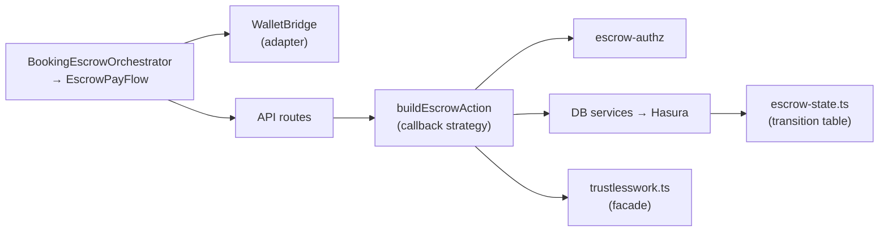
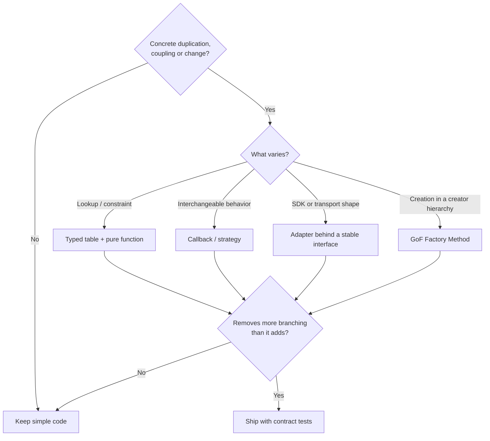

# Design-pattern filters for SafeTrust

Review rules for choosing (or not choosing) a pattern in this repo. This guide doesn't change runtime behavior.

**Source:** *Dive Into Design Patterns* (Shvets), demo v2021-2.28. The demo includes OOP basics, design principles and the **Factory Method** chapter only. The other pattern names below are project interpretations, not summaries of chapters the demo leaves out.

**Core ideas from the book:** isolate what varies; every abstraction has a complexity cost; Factory Method needs a creator **hierarchy**, so a plain function that creates something is not Factory Method.

## What SafeTrust uses today

| Pattern | Where | Note |
|---|---|---|
| Orchestration (UI) | `components/booking/BookingEscrowOrchestrator.tsx` | Picks apartment or hotel data, renders review, hands off to `EscrowPayFlow` |
| Orchestration (API) | `routes/auth/sync-user.*` → `services/user-provisioning.ts` | Route → handler → services |
| Strategy (callback) | `routes/escrow/build-escrow-action.ts` | Shared workflow; each action supplies `request(ctx)` |
| State machine (table) | `domain/escrow-state.ts` | `ESCROW_TRANSITIONS` + DB triggers; not GoF State classes |
| Adapter / Facade | `lib/wallet/use-wallet-bridge.ts` | One `WalletBridge` over wallet SDKs; provider branches still inside |
| Facade | `services/trustlesswork.ts` | Provider config, transport, errors |
| Data-access boundary | `services/hasura.ts`, `lib/hasura.ts` | Two helpers coexist; merging them is a candidate |
| Simple factory | `app.ts: createApp()` | Builds the Express app; not GoF Factory Method |
| GoF Factory Method | — | Not present; don't use the name for plain creator functions |

Orchestration, finite-state machines and compute resource consolidation are **architecture** ideas, not GoF patterns. Consolidation is a deployment claim; code reuse or merging helpers doesn't prove it.



## Choosing a pattern



1. **Problem first.** No concrete example of duplication or coupling means no pattern.
2. **Extend the existing boundary** (service, hook, helper) before adding a layer.
3. **Extract only what varies.** Keep the shared workflow in one place.
4. **Data before classes.** Lookups go in typed tables; different algorithms go in callbacks or interfaces.
5. **Server owns the truth.** Authorization, amounts, roles and lifecycle stay in `apps/api` and the database.
6. **Test the contract** at the changed boundary, including failures.

`if` branches and ternaries are something to examine, not proof of bad design. Two clear variants with guard clauses are fine.

## Rules any refactor must keep

| Data | Owner |
|---|---|
| Request body and IDs | Route validation, before provider calls |
| Caller wallet and signer | `escrow-authz`, from server records |
| Amount and roles | Stored escrow / server terms, never the client |
| Status changes | `ESCROW_TRANSITIONS` + DB triggers |
| Unsigned XDR | `buildEscrowAction` → `pending-actions` (hash, expiry, owner) |
| Retries | Pending actions + `Idempotency-Key` |
| Tenant | Kept through every shared service |

## Next applications (by priority)

1. **New escrow action:** add a `request(ctx)` callback to `buildEscrowAction`; no new classes.
2. **Hasura helpers:** list the callers and error contracts of both, then merge into one transport.
3. **Wallet signing:** one adapter per SDK behind `WalletBridge.sign`. The selected provider, account and network must be the ones used; Pollar is rejected explicitly.
4. **Lifecycle:** change only the canonical transition table and the DB together, with the parity test.
5. **Events:** add an event boundary only when consumers need independent retries, and design durable delivery first.

## Decision record (copy into the issue or PR)

```text
Problem:        <concrete duplication, coupling or defect>
Evidence:       <paths and callers>
Varies:         <what changes independently>
Stays:          <workflow and domain rules kept>
Decision:       <plain function | typed table | existing boundary | named pattern>
Data authority: <layer that supplies trusted values>
Failures:       <invalid input, provider error, retry, concurrency>
Tests:          <contracts verified>
Tradeoff:       <complexity added and why it pays off>
```
