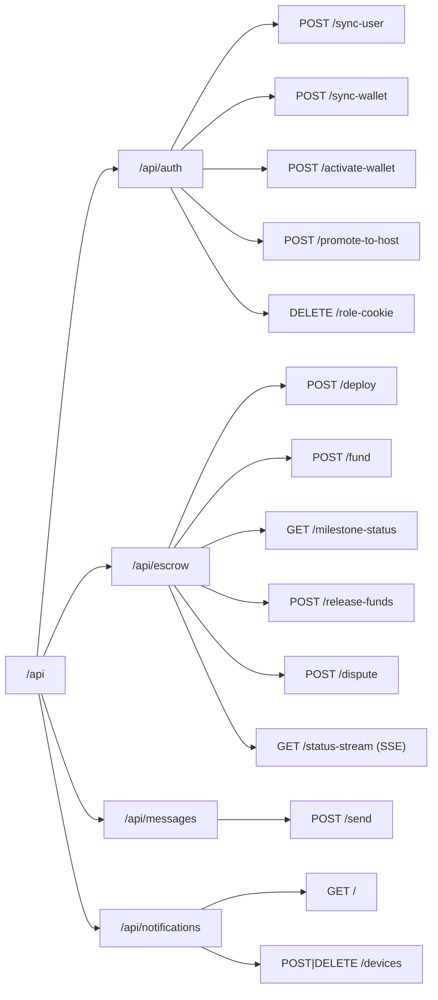

# API Routes Reference

All routes are served by `apps/api` on port 3002. Every write operation
in SafeTrust goes through this service.

## Route map



## Auth routes

| Method | Path | Auth | Description |
|---|---|---|---|
| `POST` | `/api/auth/sync-user` | Firebase token | Upsert user in `public.users` |
| `POST` | `/api/auth/sync-wallet` | Firebase token | Upsert Stellar wallet in `public.user_wallets` |
| `POST` | `/api/auth/activate-wallet` | Firebase token | Activate Pollar embedded wallet (LATAM) |
| `POST` | `/api/auth/promote-to-host` | Firebase token | Insert host role in `public.user_roles` |
| `DELETE` | `/api/auth/role-cookie` | None | Clear httpOnly role cookie (server-side) |

## Escrow routes

| Method | Path | Auth | Description |
|---|---|---|---|
| `POST` | `/api/escrow/deploy` | Firebase token | Deploy Soroban escrow, returns unsignedXDR |
| `POST` | `/api/escrow/fund` | Firebase token | Submit signed fund transaction |
| `GET` | `/api/escrow/milestone-status` | Firebase token | Get milestone status from TrustlessWork |
| `POST` | `/api/escrow/release-funds` | Firebase token | Release funds to host |
| `GET` | `/api/escrow/status-stream` | Firebase token | SSE stream for real-time escrow status |

## Notification routes

| Method | Path | Auth | Description |
|---|---|---|---|
| `GET` | `/api/notifications` | Firebase token | The signed-in user's dashboard notifications |
| `POST` / `DELETE` | `/api/notifications/devices` | Firebase token | Register / remove a push device |

### `GET /api/notifications`

Powers the notifications panel of the role escrow dashboard. Everything in the
response comes from data the API already records; nothing is generated.

Query: `limit` (optional integer 1-100, default 50) caps the lifecycle **events**.
Pending actions are never dropped by the limit. An invalid `limit` is a `400`
with code `INVALID_LIMIT`.

The response is scoped to the caller: the user comes from the verified Firebase
token, never from the request. It is sent with `Cache-Control: no-store`.

```json
{
  "notifications": [
    {
      "id": "action:<escrowId>:fund",
      "kind": "pending_action",
      "type": "alert",
      "message": "Fund the escrow for Casa Azul to secure the deposit.",
      "timestamp": "2026-11-02T10:00:00.000Z",
      "read": false,
      "escrowId": "<uuid>", "apartmentId": "<uuid>", "conversationId": null,
      "action": "fund"
    },
    {
      "id": "event:<messageId>",
      "kind": "event",
      "type": "payment",
      "message": "Deposit of 100 USDC is locked in escrow on Stellar Testnet.",
      "timestamp": "2026-11-03T10:00:00.000Z",
      "read": false,
      "escrowId": "<uuid>", "apartmentId": "<uuid>", "conversationId": "<uuid>",
      "eventType": "escrow_funded",
      "txUrl": "https://stellar.expert/explorer/testnet/tx/<hash>"
    }
  ]
}
```

Order: pending actions first (newest first), then lifecycle events newest first.
A user with no escrows and no messages gets `{ "notifications": [] }`.

**Lifecycle events** (`kind: "event"`) are the automated messages written by
`conversation-events.ts` in the user's conversations: `escrow_created`,
`escrow_funded`, `milestone_completed`, `milestone_approved`, `funds_released`,
`dispute_opened`, `dispute_resolved`. `read` follows the caller's own
last-read marker on the conversation. `type` is `payment` for funded / released,
`alert` for disputes and `milestone` otherwise.

**Pending actions** (`kind: "pending_action"`, always `type: "alert"`) are what
the user can do on an escrow *right now*, from its status and the role the
user's wallet holds. They reuse the rules the action routes enforce
(`ESCROW_ACTIONS` x `ACTION_ROLE`), so the dashboard never offers an action the
API would reject:

| Escrow status | Who | `action` |
|---|---|---|
| `created` | guest (sender) | `fund` |
| `funded`, stay not yet marked complete | host (receiver) | `mark_milestone_completed` |
| `funded`, host has marked the stay complete | guest (sender) | `approve_milestone` |
| `milestone_approved` | guest (release signer) | `release_funds` |
| `disputed` | platform wallet (`PLATFORM_STELLAR_ADDRESS`) | `resolve_dispute` |

"Marked complete" is the confirmed `milestone_completed` lifecycle message, which
the database only accepts once the milestone is confirmed. Escrows in any other
status (`completed`, `cancelled`, `resolved`, still deploying) produce nothing.

## Middleware stack

```
Request
  │
  ├── cors()
  ├── express.json()
  ├── tenantMiddleware        ← reads X-Tenant-ID header, defaults to 'safetrust'
  ├── authenticateFirebase    ← per-route, verifies Firebase JWT
  └── route handler
```

## Health check

```
GET /health → { "status": "ok" }
```

Used by Docker Compose healthcheck and the `HasuraDownBanner` frontend component.