# Frontend visual evidence (issue #519)

Screenshots of the **source UI** that `inventory.md` and `routes.md` describe, captured from a real browser against a locally built copy of [`safetrustcr/frontend-SafeTrust`](https://github.com/safetrustcr/frontend-SafeTrust) at the pinned commit. They illustrate what phases P3–P5 of `plan.md` port into `apps/frontend`; they are **not** screenshots of `apps/frontend` itself.

## Provenance

| Item | Value |
| --- | --- |
| Source repository | `safetrustcr/frontend-SafeTrust` |
| Source commit | `c46c11593312bf0a8b9de445107293eb9a9dbea3` (merge commit of PR #644, equals `origin/main`) |
| Destination base | `dApp-SafeTrust@3e120c5063f8fe866d6425a471c12f49541d38ee` |
| Installation | `npm ci` on Node 22.23.2 |
| Build / serve | `next build`, then `next start` on `127.0.0.1` |
| Capture tool | Playwright Chromium, `deviceScaleFactor: 1`, no zoom |
| Theme | `colorScheme` plus the app's persisted `safetrust-theme` key set before first paint |
| Viewports | 360 × 800 (mobile), 768 × 1024 (tablet), 1280 × 900 (desktop) |
| Environment | `NEXT_PUBLIC_DEMO_MODE=true`, `NEXT_PUBLIC_USE_AUTH_EMULATOR=true`, Firebase demo config — no production project, no real user data |

Because the app runs with its demo flag on, the thin banner at the top of every image ("You're viewing SafeTrust with demo listings…") belongs to the local capture environment, not to the ported design. It comes from `demo-badge`, classified as `copy` in `inventory.md` §5.14.

## `/` — public home

Target route: `/` in `apps/frontend`. Hero, escrow explainer, popular destinations, supported-by and how-it-works blocks (`home/*`, `listings/destinations/*`).

| 360 px | 768 px | 1280 px |
| --- | --- | --- |
| 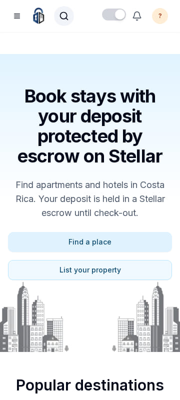 | 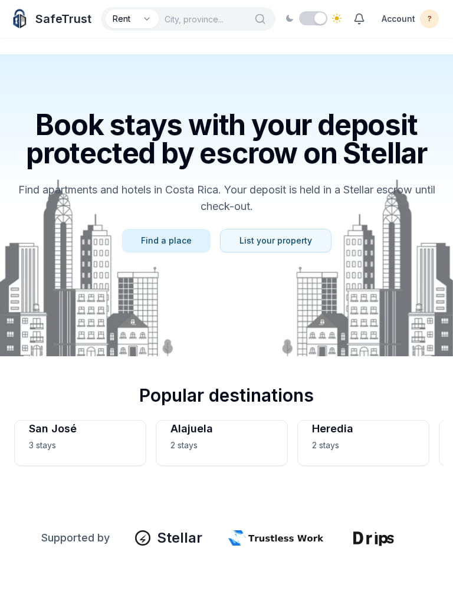 | 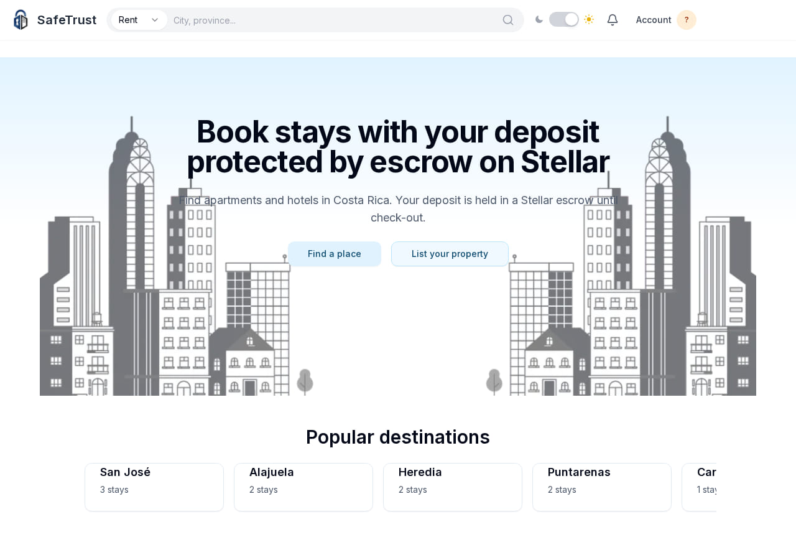 |
| 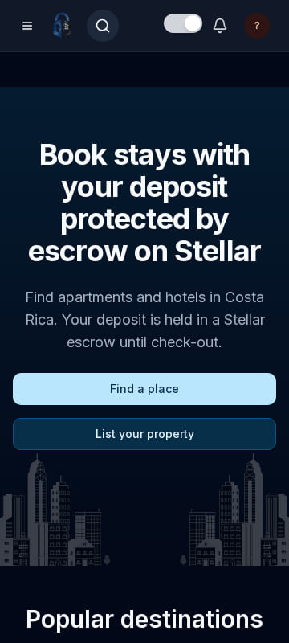 | 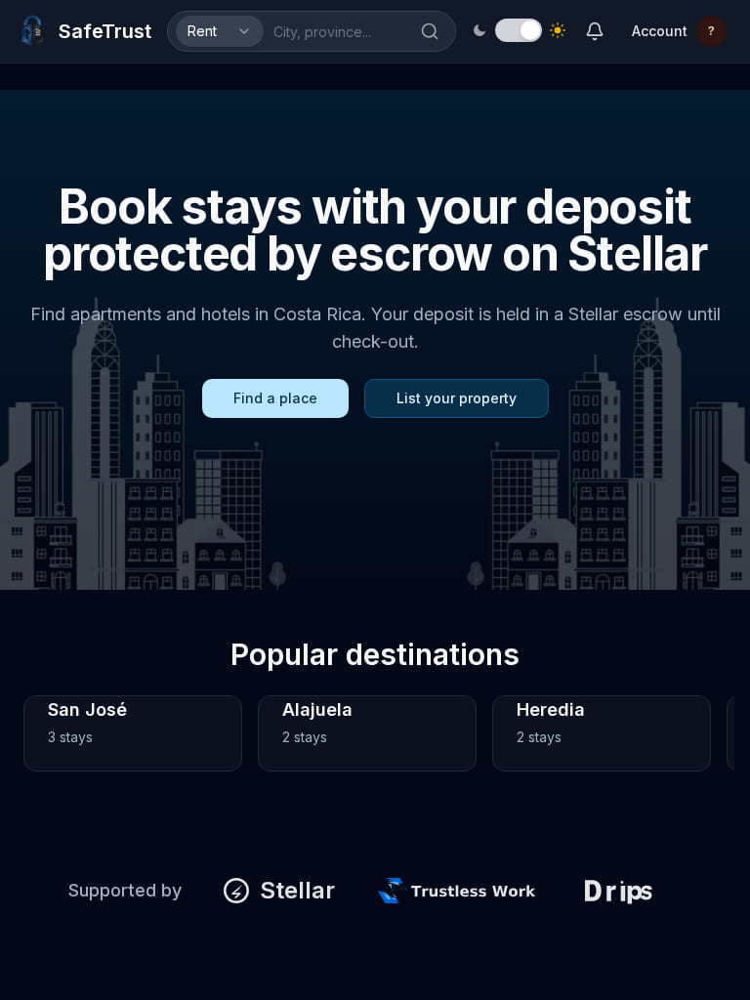 | 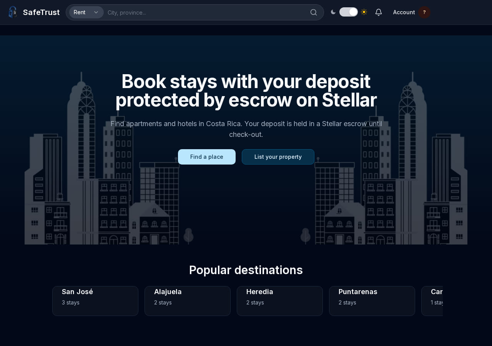 |

<sub>Top row: light theme. Bottom row: dark theme.</sub>

## `/rent` — listing and filters

Target route: `/rent` in `apps/frontend`. Search header, destination and price-range filters, listing grid. `routes.md` keeps the live `/rent` route and swaps in `components/listings/*`.

| 360 px | 768 px | 1280 px |
| --- | --- | --- |
| 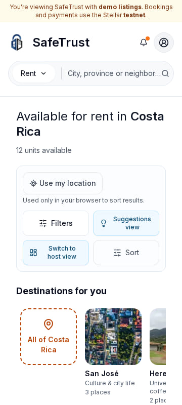 | 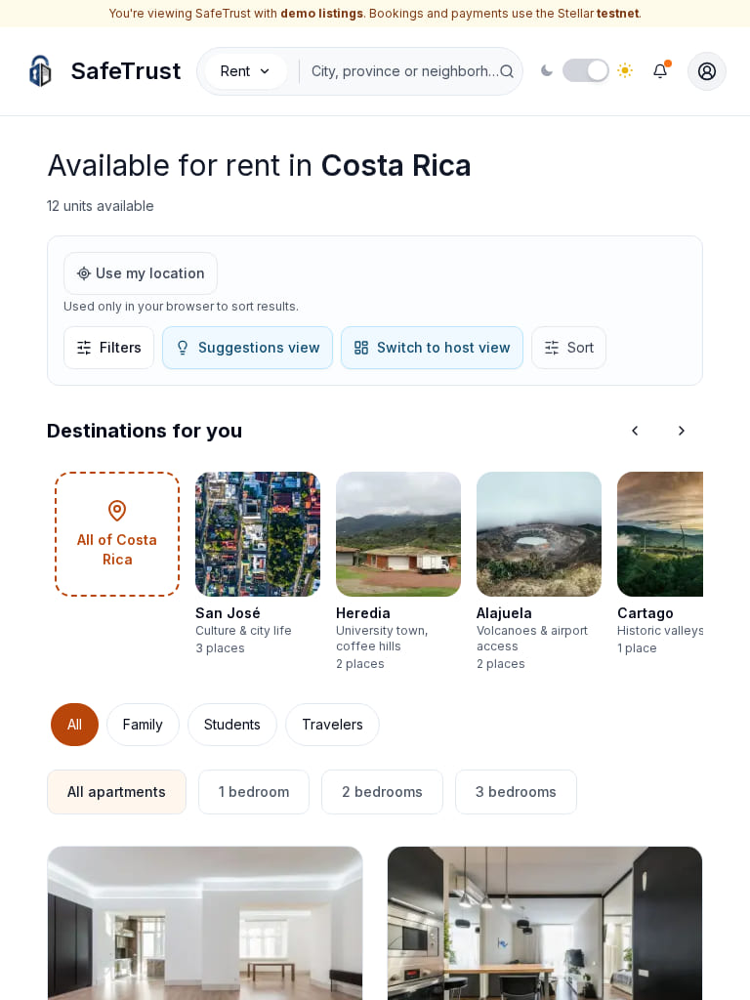 | 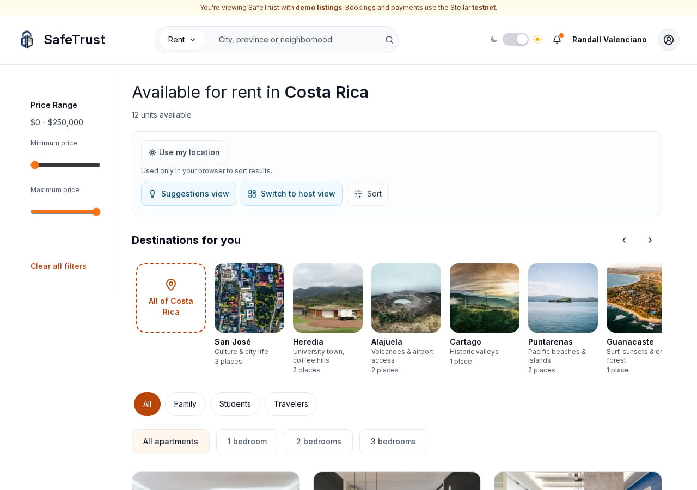 |
| 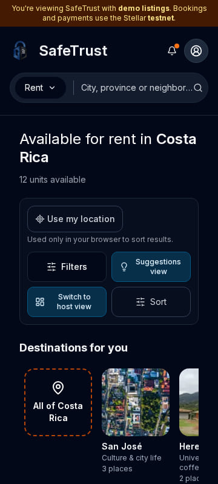 | 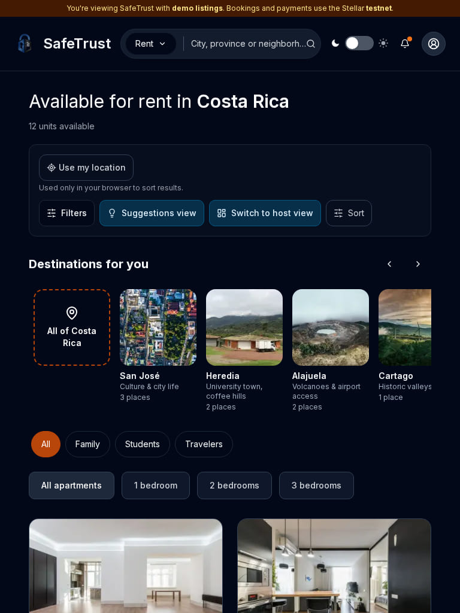 | 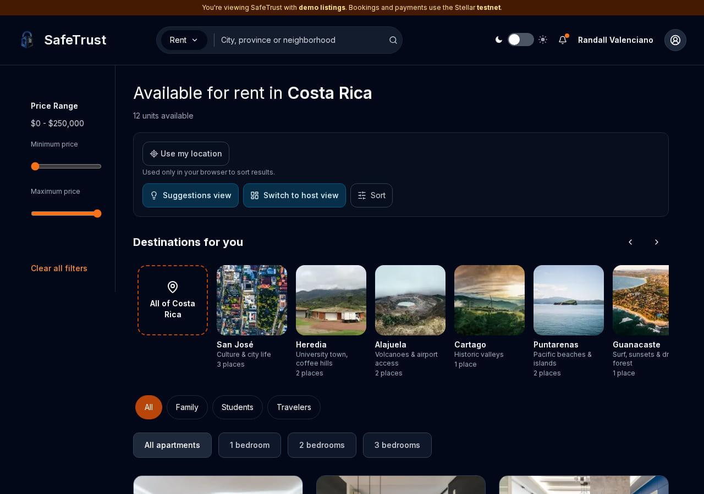 |

<sub>Top row: light theme. Bottom row: dark theme.</sub>

## `/room` — stay detail

Target route: `/apartment/[id]` in `apps/frontend`. Gallery, rating, nightly price, booking bar and location block (`listings/ApartmentDetail`, `ImageGallery`, `BookingSummaryBar`).

| 360 px | 768 px | 1280 px |
| --- | --- | --- |
| 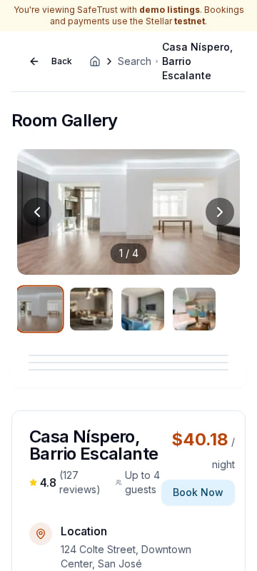 | 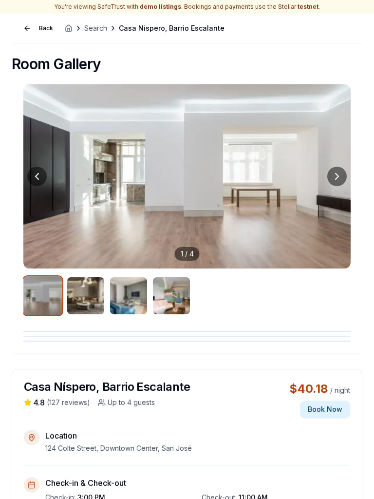 | 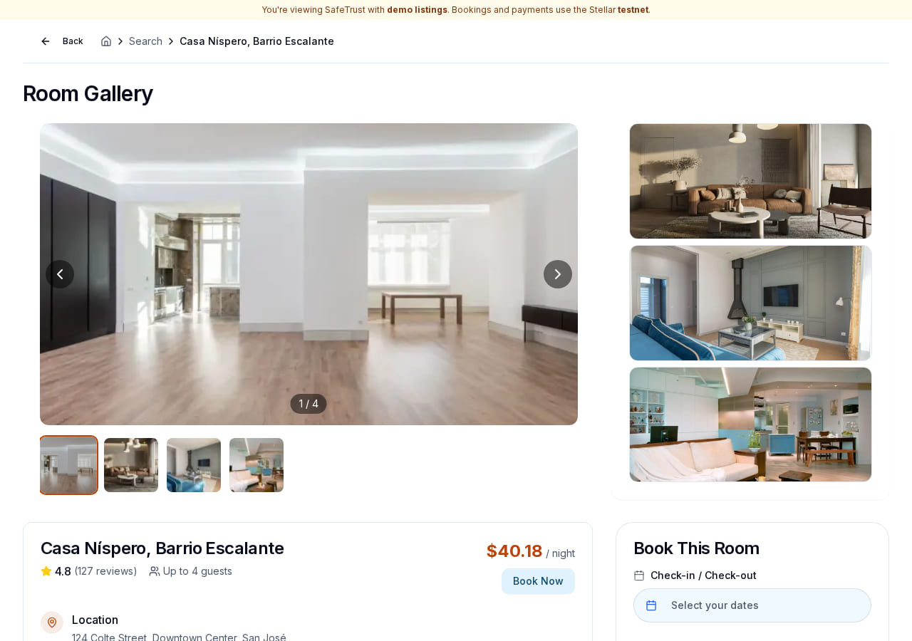 |
| 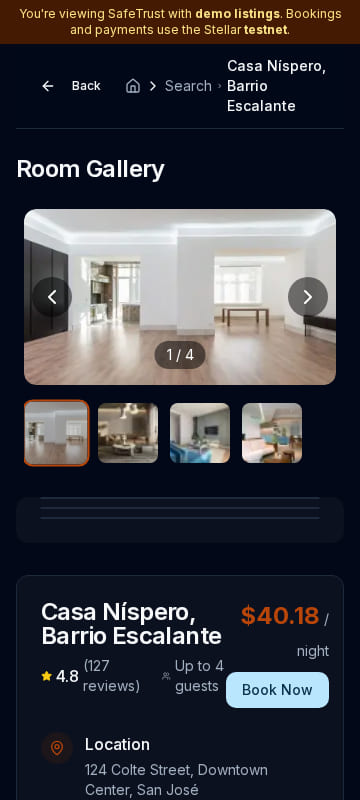 | 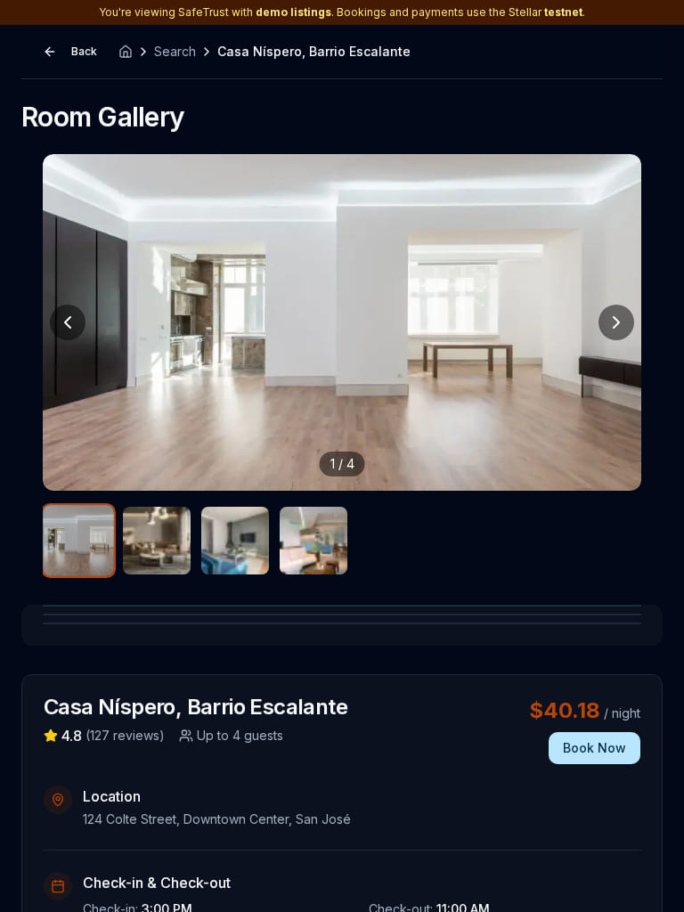 | 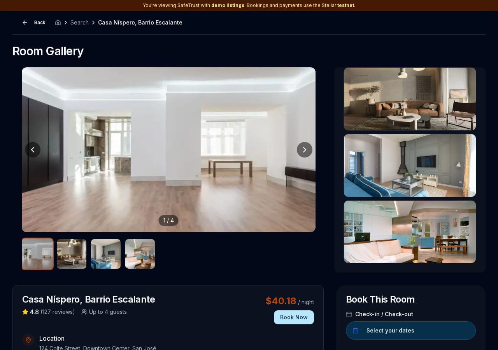 |

<sub>Top row: light theme. Bottom row: dark theme.</sub>

Each image is a viewport screenshot, not a full-page capture: the pages are taller than the 900 px window at 1280 px, so below-the-fold sections are intentionally cropped.

## Capture checks

Recorded from the same browser session that produced the images:

| Route | `<h1>` | Content images decoded | Dark theme | Horizontal overflow at 360 px |
| --- | --- | --- | --- | --- |
| `/` | "Book stays with your deposit protected by escrow on Stellar" | 5 of 8 (the other three are hidden 0 × 0 brand SVGs, not broken slots) | `class="dark"`, body `rgb(2, 8, 23)` | none |
| `/rent` | "Available for rent in Costa Rica" | 20 of 20 | `class="dark"`, body `rgb(2, 8, 23)` | none |
| `/room` | "Room Gallery" | 10 of 10 | `class="dark"`, body `rgb(2, 8, 23)` | none |

## What is deliberately not captured

There are no screenshots of the **current destination UI** (`apps/frontend`) in this set. At the pinned base `3e120c5` that app does not render reliably in the review environment:

- `pnpm build` fails on `apps/frontend/src/components/ui/card.tsx` (`JCardTitle` syntax error) and on `apps/api` type errors — recorded in `baseline.md` §2.
- The dev server serves `/rent`, but `/` redirects to `/login`, which recompiles into the same `card.tsx` syntax error and the process exits; a later request to `/rent` on the same server is refused.

Producing "destination UI" images would therefore have meant patching `card.tsx`, which is P0 work and outside issue #519's documentation-only scope. The contrast between the two UIs is described in `inventory.md`; the only visual evidence available without code changes is the source UI above.

## Regenerating

```bash
git clone https://github.com/safetrustcr/frontend-SafeTrust /tmp/frontend-SafeTrust
cd /tmp/frontend-SafeTrust
git checkout c46c11593312bf0a8b9de445107293eb9a9dbea3
npm ci && npm run build
NEXT_PUBLIC_DEMO_MODE=true NEXT_PUBLIC_USE_AUTH_EMULATOR=true npx next start -p 3123
```

Then capture `/`, `/rent` and `/room` at 360 × 800, 768 × 1024 and 1280 × 900 in both themes with a Playwright script that sets `safetrust-theme` in `localStorage` before navigation and waits for hydration.
